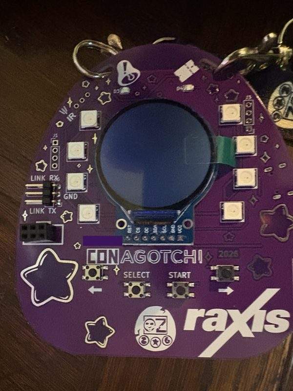

# Conagotchi

Alternative Rust firmware for the Conagotchi 2026 conference badge (ESP32-S3). It keeps the badge social and adds a host-controllable playground on top:

- Chi trades with stock badges, with contacts saved for every badge you trade with;
- an animated pet;
- a BLE GATT service and live radio metrics;
- LED animations kept in step across badges running this firmware;
- a host tool, `badgectl`, that drives everything over the USB debug link.

Your stock files, the radio key and DOOM stay on the badge.

## Quick start (new badge)

You need [Nix](https://nixos.org/download) and a USB-C cable. Plug the badge in and run these three commands:

1. `nix shell nixpkgs#espflash`
2. `curl -LO https://github.com/jvishnefske/conagotchi/releases/latest/download/conagotchi-merged.bin`
3. `espflash write-bin 0x0 conagotchi-merged.bin`

The badge reboots into the new firmware. On first boot it copies its radio key from the stock filesystem, so trades with stock badges stay signed. If the screen stays dark, unplug the badge, remove the battery for a moment, and power it up again.

Use the arrow buttons to move between screens. SELECT acts on the current screen: trade, scan or change the LED pattern.

To keep a backup of the stock firmware, build `badgectl` (`cargo build --release -p badgectl`) and run `badgectl adopt` instead. It backs up the badge, flashes it after one confirmation, and `badgectl restore` puts the stock firmware back.

Requirements, architecture and hardware notes are in [design.md](design.md).
